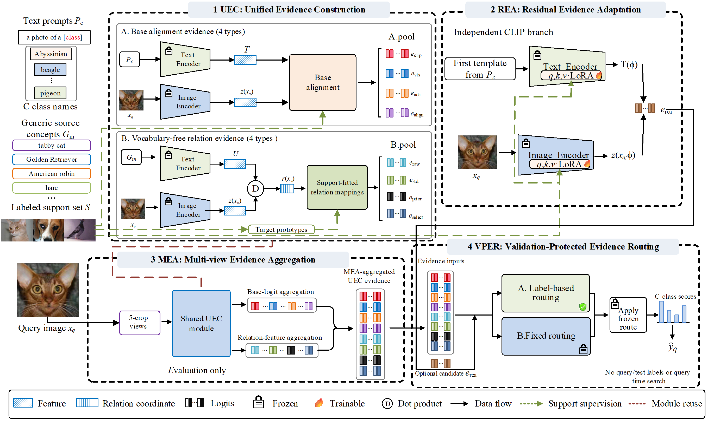

# SERA: Support Evidence Routing and Adaptation

This repository contains the implementation and reference results for
**SERA: Support Evidence Routing and Adaptation for FSIC with VLM**.
SERA is a few-shot image classification method built on CLIP. It constructs
complementary prediction evidence in a shared class-logit space and selects
a prediction route using the data permitted by the evaluation protocol.

SERA consists of four components:

- **Unified Evidence Construction (UEC)** combines base alignment evidence
  and vocabulary-free relation evidence.
- **Residual Evidence Adaptation (REA)** learns an independent residual
  candidate from labeled support images.
- **Multi-view Evidence Aggregation (MEA)** aggregates deterministic FiveCrop
  logits and normalized image features from the base path at evaluation time.
- **Validation-Protected Evidence Routing (VPER)** selects a branch or
  probability-fusion rule under the validation, support-only, or fixed protocol.

REA is a parallel candidate branch. It is evaluated separately from MEA and
is added to the VPER candidate pool rather than the UEC baseline pool.
Query and test labels are used only to calculate final accuracy.

<p align="center">
  
</p>

**Framework overview.** UEC constructs base alignment and vocabulary-free
relation evidence. REA provides an independent support-trained candidate.
MEA stabilizes the base evaluation path, and VPER freezes the selected rule
before query inference. The figure is reproduced from the manuscript.

## Repository Contents

| Path | Contents |
| --- | --- |
| [`assets/`](assets/README.md) | Manuscript framework overview in PNG and EMF formats |
| [`configs/`](configs/README.md) | Formal experiment settings and protocol definitions |
| [`datasets/`](datasets/README.md) | Dataset loaders, frozen split metadata, and reference file inventory |
| [`docs/`](docs/README.md) | Method-to-code mapping, resource preparation, and reproduction guides |
| [`outputs/`](outputs/) | Generated experiment outputs; only a placeholder is tracked |
| [`resources/`](resources/README.md) | Included text-feature caches and CLIP checkpoint preparation instructions |
| [`results/`](results/README.md) | Frozen full-method and ablation results, comparison values, and paper tables |
| [`scripts/`](scripts/README.md) | Resource preparation, experiment execution, table reconstruction, and verification scripts |
| [`sera/`](sera/README.md) | Core SERA implementation, CLIP-compatible encoder, and low-rank adaptation layers |
| [`third_party/reference_clip/`](third_party/reference_clip/) | Bundled reference CLIP implementation and retained source notices |
| [`train.py`](train.py) | Training and evaluation command-line entry point |
| [`environment.yml`](environment.yml) | Conda environment definition |
| [`requirements.txt`](requirements.txt) | Pinned Python dependencies, including the reference CUDA builds |
| [`pyproject.toml`](pyproject.toml) | Python package configuration and installed `sera` command |
| [`README_SUPPLEMENTARY.txt`](README_SUPPLEMENTARY.txt) | Supplementary setup and execution guide |
| [`THIRD_PARTY.md`](THIRD_PARTY.md) | Summary of bundled third-party components and notices |
| [`.gitignore`](.gitignore) | Exclusions for local data, checkpoints, generated outputs, and caches |

The source distribution includes the implementation, environment specifications,
split metadata, experiment scripts, and complete reference result archive.
Dataset images, pretrained CLIP checkpoints, and generated outputs are
prepared separately. The 39 reference text-feature caches are included in a
compressed resource archive. See [Dataset Preparation](docs/DATASETS.md) and
[Model Resources](docs/RESOURCES.md).

## Main Results

The following table reports mean top-1 accuracy (%) across the eleven datasets
for each backbone and shot setting. Values come from the archived full-SERA
records and are displayed to two decimal places.

| Backbone | 1 shot | 2 shot | 4 shot | 8 shot | 16 shot |
| --- | ---: | ---: | ---: | ---: | ---: |
| ViT-B/32 | 71.32 | 73.46 | 75.87 | 78.95 | 80.98 |
| ViT-B/16 | 74.95 | 77.67 | 79.84 | 82.81 | 85.06 |
| ViT-L/14 | 80.84 | 82.62 | 84.67 | 86.79 | 88.84 |

The complete grid contains 11 datasets, three backbones, and five shot settings
(165 cells). The mean across all 165 cells and the corresponding controlled
variants are shown below, rounded to two decimal places:

| Configuration | Mean top-1 accuracy (%) |
| --- | ---: |
| SERA-V (`SERA_val` in archived records) | 80.31 |
| SERA-V w/o VFR | 80.05 |
| SERA-V w/o BA | 79.07 |
| SERA-V w/o REA | 79.22 |
| SERA-SO (support-only routing) | 77.25 |
| SERA-SF (fixed routing) | 79.48 |
| SERA-V w/o MEA | 79.77 |

See [Reference Results](results/README.md) for individual cells, ablations,
external-method comparison tables, and archive provenance.

## Quick Start

The reference environment is Linux with Python 3.10, PyTorch 2.5.1 with CUDA
12.1, torchvision 0.20.1 with CUDA 12.1, and NumPy 2.2.6. Run the following
commands from the repository root:

```bash
conda env create -f environment.yml
conda activate sera
python scripts/verify_package.py --source-only
python scripts/rebuild_paper_tables.py
```

Prepare the eleven datasets following the [data guide](docs/DATASETS.md).
The resource command downloads the three reference CLIP checkpoints and restores
the included text-feature caches. The preparation command validates all
downloaded and restored files:

```bash
python scripts/prepare_model_resources.py
bash scripts/link_resources.sh /path/to/dataset-root
python scripts/verify_package.py
python scripts/verify_reference_data.py
python scripts/check_environment.py
```

Run one complete SERA experiment:

```bash
bash scripts/run_experiment.sh caltech101 vit_b16 1 full_val 2024
```

The arguments specify dataset, backbone, shots per class, protocol, and seed.
Fresh JSON records are written under `outputs/<protocol>/`. The launcher checks
the numerical environment before training. Set `PYTHON_BIN` to the verified
environment's Python executable when that environment is not already active.

## Reproducing Paper Experiments

| Experiment | Command |
| --- | --- |
| Complete SERA with validation routing | `bash scripts/reproduce_grid.sh full_val` |
| SERA without REA | `bash scripts/reproduce_grid.sh no_rea` |
| SERA without MEA | `bash scripts/reproduce_grid.sh no_mea` |
| Support-only routing | `bash scripts/reproduce_grid.sh support_only` |
| Fixed routing | `bash scripts/reproduce_grid.sh support_fixed` |
| Paired UEC evidence-group ablations | `bash scripts/reproduce_uec_internal_grid.sh` |

Each command evaluates the 165-cell grid with seed 2024. The paired UEC
experiment evaluates removal of each evidence group using the same trained
model and collected logits for a cell. It produces 165 paired JSON files
containing 330 controlled-variant results.

Detailed settings and the archived rerun validation are documented in
[Reproducibility](docs/REPRODUCIBILITY.md). Use `scripts/run_experiment.sh` to
run an individual cell before launching a complete grid.

The paper and the implementation use the following corresponding names:

| Paper notation | Launcher protocol | Archived record name |
| --- | --- | --- |
| SERA-V | `full_val` | `SERA_val` |
| SERA-SO | `support_only` | `SERA_support_only` |
| SERA-SF | `support_fixed` | `SERA_support_fixed` |

BA denotes base alignment evidence; VFR denotes vocabulary-free relation
evidence. `base_alignment_only` is SERA-V w/o VFR, and
`vocabulary_free_relation_only` is SERA-V w/o BA.

## Notes

- The formal evidence-pool profile is `balanced`. Its UEC pool contains base
  alignment and vocabulary-free relation evidence.
- `full_val` uses routing-validation labels for protected route selection.
  The ImageNet validation/query partition is described in the data guide.
- `support_only` selects routes using support labels. `support_fixed` performs
  no label-based route search and uses the predefined probability-fusion rule.
- MEA applies to the base path; REA remains single-view.
- All public launchers set `lora_position=all`. Historical `no_rea` records
  contain an inactive `top3` metadata value because both REA entry points are
  disabled in those runs.
- The canonical reference tree contains 990 JSON files representing 1,155
  reported results. The paper archive also preserves copies of the original
  experiment records; those copies do not represent additional experiments.
- Fresh training and validation-route selection can vary in stochastic cells.
  The frozen records define the archived paper results.

## Acknowledgement

SERA builds on [CLIP](https://github.com/openai/CLIP). The bundled components
and retained source notices are described in [THIRD_PARTY.md](THIRD_PARTY.md).
